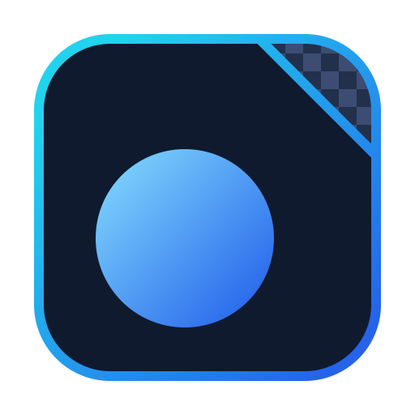
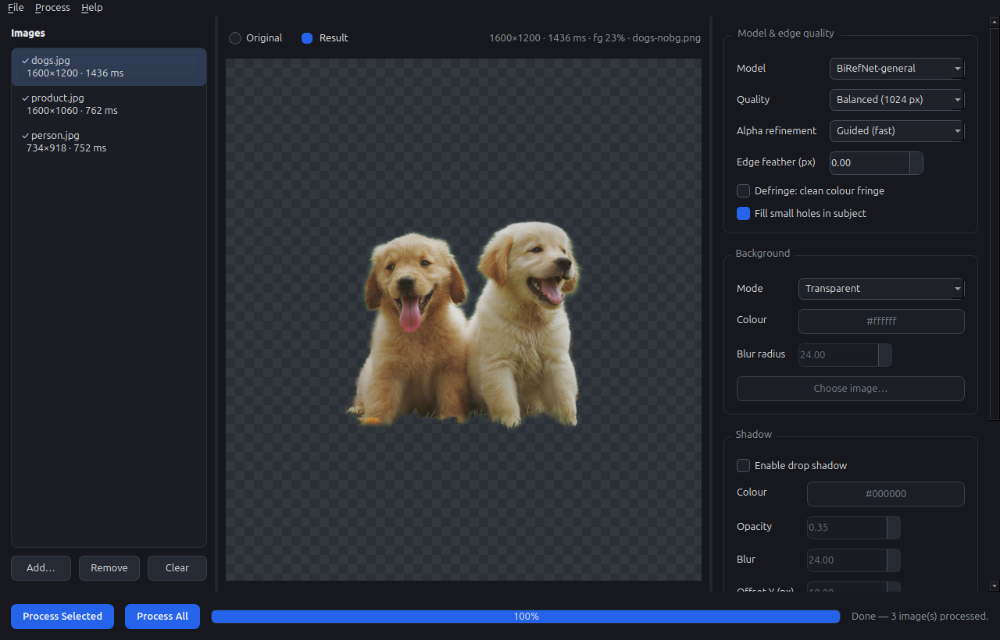
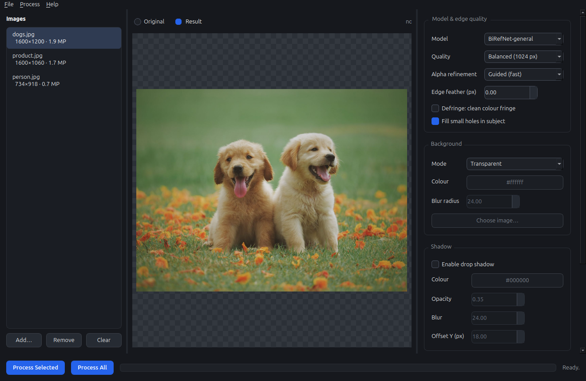
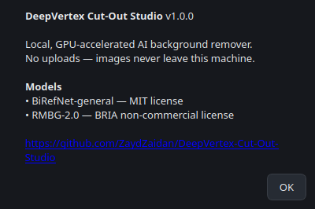
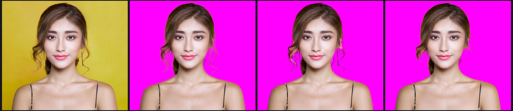
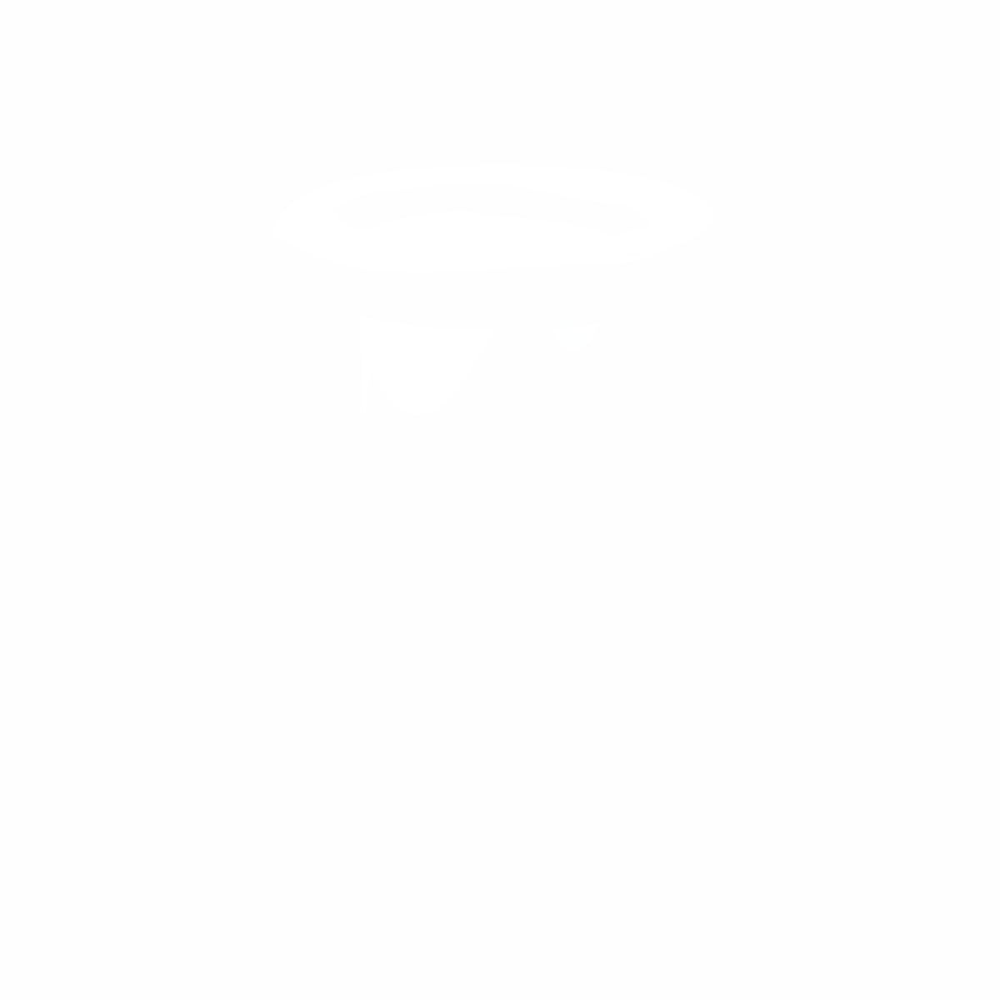
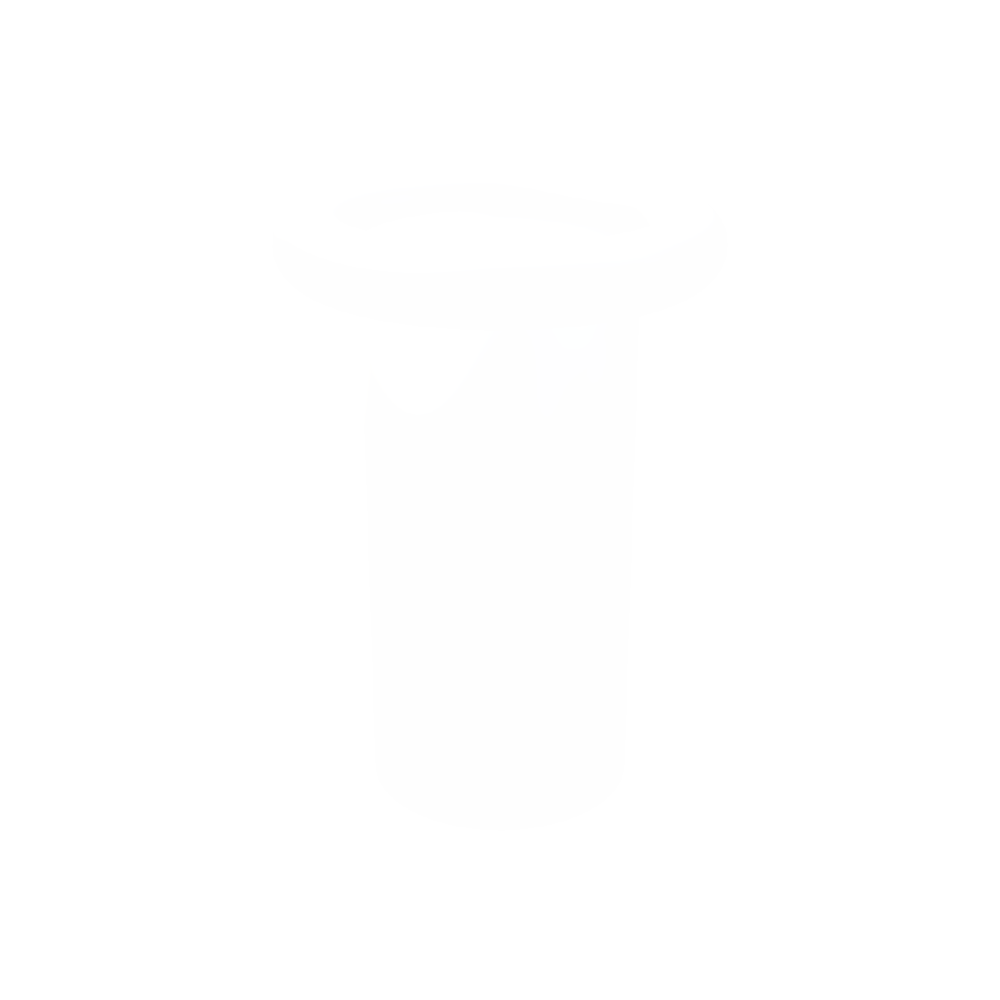
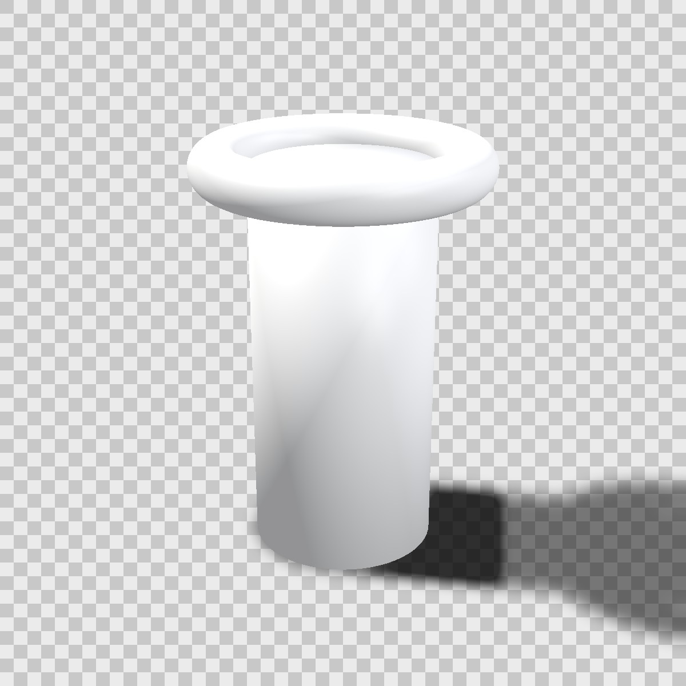

<div align="center">



# DeepVertex Cut-Out Studio

**Local, GPU-accelerated AI background remover for Linux — no uploads, no accounts, no credits.**

[](https://github.com/ZaydZaidan/DeepVertex-Cut-Out-Studio/actions/workflows/ci.yml)
[](LICENSE)
[](#)
[](#)

Remove backgrounds from photos entirely on your own machine with
state-of-the-art alpha-matting models (BiRefNet by default). Built as a
[clean-room reconstruction](docs/RECON_REPORT.md) of the remove.bg workflow —
no remove.bg assets, weights, or code are used.

</div>

<div align="center">

| | |
|---|---|
|  |  |
|  |  |

</div>

---

## Why

Cloud background removers work well but bind you to quotas, quality tiers,
watermarks, and — most importantly — to sending every photo to a server.
Cut-Out Studio runs the same *kind* of pipeline locally: your images never
leave the machine, there are no rate limits, and the full-quality output is
free because your own GPU does the work.

## Features

- **Local matting engine** — [BiRefNet](https://huggingface.co/ZhengPeng7/BiRefNet)
  (MIT, default) or [RMBG-2.0](https://huggingface.co/briaai/RMBG-2.0)
  (BRIA, non-commercial, gated), via Hugging Face `transformers`, running on
  CUDA (tested on an RTX 5050, `sm_120`) with automatic CPU fallback.
  Choices of inference resolution: **Fast / Balanced / Max** (768 / 1024 / 1536 px).
- **3D Product Snapshot** (new in 1.1.0) — turn a **STEP / STL / OBJ / PLY /
  GLB** model into a full set of webshop-ready images: the six CAD views,
  the 3/4 *hero* angles, custom turntable spins, on a **transparent** canvas,
  a **pure-white** Amazon-style main image, a **studio** gradient with soft
  contact shadow, dark/sunset backdrops, or any solid colour. Rendering is
  local GPU/OpenGL — study in [`docs/3D_SNAPSHOT_RECON.md`](docs/3D_SNAPSHOT_RECON.md).

|  |  |  |
|---|---|---|
| Studio gradient | Pure-white main image | Transparent + shadow (checker preview) |

- **Edge quality controls** — guided-filter alpha refinement (fast, default) or
  closed-form alpha matting via [pymatting](https://github.com/pymatting/pymatting)
  (best hair/glass edges, slower, auto-skipped above ~4 MP), edge feathering,
  background-colour decontamination (*defringe*), and automatic filling of
  micro-holes inside the subject.
- **Composition** — export with transparency, a solid colour, the blurred
  original scene, or a custom background image; optional soft drop shadow.
- **Output** — PNG (RGBA), WebP, or flattened JPG; configurable filename
  suffix and output directory.
- **GUI** (PySide6/Qt6) — drag & drop, thumbnail queue, before/after preview
  over a checkerboard, batch processing in a background worker thread,
  keyboard shortcuts, tooltips on every control, rebrandable dark UI.
- **CLI** — scriptable batch processing over folders for automation.
- **Privacy by design** — nothing is uploaded; the only network traffic is
  the one-time model download from the Hugging Face Hub.

## Installation

### Requirements

- Python **3.10+** (tested on 3.12), Linux with X11/Wayland, ~4 GB free disk
  for the model weights, and preferably a CUDA GPU (CPU works too, just slower).

### 1. Create a virtual environment

```bash
cd /path/to/DeepVertex-Cut-Out-Studio
python3 -m venv venv
```

### 2. Install PyTorch first (CUDA wheel)

Install the torch wheel that matches your GPU *before* the rest, so pip does
not pull the default (often outdated) CUDA variant:

```bash
# NVIDIA CUDA 13.0 example (see https://pytorch.org/get-started/locally/ for other versions)
venv/bin/pip install torch torchvision --index-url https://download.pytorch.org/whl/cu130

# CPU-only machines:
venv/bin/pip install torch torchvision --index-url https://download.pytorch.org/whl/cpu
```

### 3. Install the app

```bash
venv/bin/pip install -r requirements.txt
venv/bin/pip install -e .
```

### 4. Run

```bash
./run.sh                    # GUI (uses ./venv automatically)
./run.sh cli --list-models  # CLI: list the models
```

or install the desktop entry (no sudo needed):

```bash
bash scripts/install-desktop-entry.sh --desktop
```

### 5. First-run model download

The model weights (~0.9 GB for BiRefNet) download automatically from the
Hugging Face Hub on first use. Pre-warm the cache without processing
anything:

```bash
./run.sh cli --prefetch-model
```

## Usage

### GUI

Launch `./run.sh` (or the desktop entry *DeepVertex Cut-Out Studio*):

1. **File → Add Images…** (`Ctrl+O`) or drag images onto the window.
2. Pick the **model**, **resolution preset**, **refinement** mode, and the
   background/shadow options on the left panel — every control has a tooltip.
3. **Process → Process Selected** (`Ctrl+Return`) or **Process All**
   (`Ctrl+Shift+Return`); progress and per-file results appear in the queue.
4. Outputs land beside the inputs (suffix `-nobg`) or in the folder you set.

**3D Product Snapshot** (`Ctrl+M`): drag a `.stl/.obj/.step/.glb` model file
onto the window (or open the dialog from the *Process* menu), choose the view
set, background and size, and render — no manual screenshots required.

### CLI

```bash
./run.sh cli INPUTS... [options]
```

`INPUTS…` are image files and/or directories (directories are searched
recursively). Accepted formats: JPEG, PNG, WebP, BMP, TIFF; EXIF orientation
is honoured.

| Option | Default | Description |
|---|---|---|
| `--model birefnet\|rmbg2` | `birefnet` | matting model (see table below) |
| `--quality fast\|balanced\|max` | `balanced` | network input resolution (768/1024/1536 px long side) |
| `--refine none\|guided\|matting` | `guided` | alpha refinement: guided filter (fast) or closed-form matting (slow, best edges) |
| `--feather PX` | `0` | softens the cutout edge by PX pixels |
| `--defringe` | off | removes background-colour fringe on hair/edge pixels |
| `--no-fill-holes` | on | keeps holes unfilled (hole filling is on by default) |
| `--bg transparent\|color\|blur\|IMAGE` | `transparent` | background mode; `IMAGE` is a path |
| `--bg-color HEX` | `#ffffff` | colour for `--bg color` |
| `--blur-radius PX` | `24` | blur radius for `--bg blur` |
| `--shadow` | off | adds a soft drop shadow |
| `--shadow-color HEX` / `--shadow-opacity F` / `--shadow-blur PX` / `--shadow-offset-y PX` | black / 0.35 / 24 / 18 | shadow look |
| `--format png\|webp\|jpg` | `png` | output format |
| `--out DIR` / `-o DIR` | beside each input | output directory |
| `--suffix TXT` | `-nobg` | output filename suffix (use `--suffix=-name` when it starts with `-`) |
| `--cpu` | auto | force CPU inference even when CUDA is available |
| `--prefetch-model` | — | download/load the model and exit (cache warm-up) |
| `--list-models` | — | print the model catalogue and exit |

Examples:

```bash
# Transparent PNGs of a whole photo folder, with defringe + shadow
./run.sh cli ~/Photos/raw -o ~/Photos/cutouts --defringe --shadow

# Blur-original background at max quality on the CPU
./run.sh cli portrait.jpg -o out/ --quality max --bg blur --cpu

# Solid dark background, JPG with a light shadow
./run.sh cli product.png -o out/ --bg color --bg-color '#0b0b0c' \
        --format jpg --shadow --shadow-opacity 0.4
```

### CLI — 3D product snapshots

```bash
./run.sh mesh MODEL.stl -o shots/ [--views ...] [--bg ...] [...]
```

| Option | Default | Description |
|---|---|---|
| (positional) `MODEL` | — | `.stl, .obj, .ply, .glb, .gltf` (native); `.step` needs the optional `[step]` extra; `.f3d` is not readable — export it from Fusion first |
| `--views` | `standard` | `standard` (6 CAD views + 2 hero) · `all` (6 + 4 hero) · `ortho` · `hero` · comma list · `turntable:N` (4–72) |
| `--bg` | `studio` | `studio` (gradient + contact shadow) · `white` (pure 255, no shadow — Amazon main image) · `transparent` (alpha PNG/WebP) · `dark` · `sunset` · `color` |
| `--bg-color` | `#ffffff` | colour for `--bg color` |
| `--shadow` | `auto` | `on` / `off` / `auto` (auto: on for studio/dark/sunset/color) |
| `--size` | `1600` | output pixel size (square) |
| `--format` | `png` | `png` / `webp` / `jpg` |
| `--fill` | `0.85` | subject fill fraction of the frame (Amazon main-image rule = 0.85) |
| `-o DIR` | `<model>-shots` | output folder |

Filename layout: `{model}-{view}.png` (e.g. `bracket-hero-front-left.png`)
plus `{model}-sheet.jpg`, a contact sheet of all views. Ideal for
marketplace galleries, turntable spins, and pre-manufacture branding.

## Models

| Key | Hugging Face repo | License | Download | Notes |
|---|---|---|---|---|
| `birefnet` | ZhengPeng7/BiRefNet | MIT | ~0.9 GB | **Default.** General purpose, strong hair/glass edges. Free for any use. |
| `rmbg2` | briaai/RMBG-2.0 | BRIA non-commercial | ~1.7 GB | **Gated repo.** Non-commercial use only. You must (1) accept the licence at the repo page and (2) run `huggingface-cli login` before selecting it. |

> Both models auto-download into the Hugging Face cache
> (`~/.cache/huggingface`) on first use.

## How it works

The pipeline was designed by reverse-engineering the *published, observable*
part of the remove.bg web workflow (frontend bundle, client-side
normalization, upload contract) and rebuilding an equivalent — better — local
pipeline. It is a **clean-room reconstruction**: no remove.bg assets, code,
weights, or brand assets are used or bundled.

1. **Normalize** (`pipeline.py`) — EXIF-transpose, cap extremely large inputs,
   convert to RGB.
2. **Matte** (`engine.py`) — the local model produces a per-pixel alpha in
   [0, 1] at the *original* resolution (the model logits are bicubically
   upsampled, so output sharpness is preserved).
3. **Refine** (`refine.py`) — guided filter or closed-form matting tightens
   edges, micro-holes are filled, feathers/defringe applied on request.
4. **Compose & export** (`compose.py`) — dropout onto the chosen background,
   optional drop shadow, PNG/WebP/JPG write.

Details, evidence, and limitations of the reverse-engineering study:
[`docs/RECON_REPORT.md`](docs/RECON_REPORT.md). Module map and data flow:
[`docs/ARCHITECTURE.md`](docs/ARCHITECTURE.md).

## Performance

Measured on an RTX 5050 laptop GPU (8 GB), 1600 px images, balanced preset,
guided refinement, auto-download disabled (warm cache):

| Modern GPU run | Result |
|---|---|
| Typical 1600 px image | **~0.7–2.5 s** each |
| Closed-form matting | ~24 s per 2.3 MP |
| CPU mode | works (slower; seconds → minutes depending on image) |

Measured foreground coverage of QA outputs (parity across the dtype/device
refactor): dogs 23.0 %, person 43.7 %, product 14.1 % — identical
before/after, which confirms numerical stability. Zero enclosed alpha holes
in the QA output (numeric check).

## Troubleshooting

- **GUI does not start from the desktop icon** — GUI stderr is logged to
  `~/.cache/cutout-studio/gui.log`; check there first.
  Qt ≥ 6.5's xcb platform plugin needs `libxcb-cursor.so.0`; on hosts without
  the system package, this repo ships the library in `runtime-libs/`
  (exported via `LD_LIBRARY_PATH` by `run.sh`) and copies it into
  `PySide6/Qt/lib`. If the GUI fails to load while the CI tests run
  green, run `bash scripts/fix-qt-libxcb.sh` (needs no sudo).
- **First run is slow / "downloading…"** — the model weights
  (~0.9 GB for BiRefNet) download once to `~/.cache/huggingface`.
  Pre-fetch with `./run.sh cli --prefetch-model`.
- **Error: model repository is gated** — you selected RMBG-2.0. Accept the
  licence at https://huggingface.co/briaai/RMBG-2.0 and run
  `huggingface-cli login`, then retry; the default BiRefNet model needs no
  login.
- **`HuggingFace couldn't connect` on offline machines** — no problem if the
  model is already cached; if not, download it once on a networked machine
  and copy `~/.cache/huggingface` over.
- **Very slow `--refine matting`** — closed-form is a linear solve; it is
  skipped automatically above ~4 MP images in favour of the guided filter.

## Development

```bash
venv/bin/pip install -e ".[dev]"          # dev tools (each person's own env)
venv/bin/ruff check .                     # lint (CI runs this too)
venv/bin/python -m pytest -q              # 22 tests (no GPU / no torch needed)
venv/bin/python scripts/gui_smoke.py OUT  # offscreen GUI exercise
venv/bin/python scripts/quality_check.py OUT IMAGES...
venv/bin/python scripts/ux_audit.py OUT   # widget geometry / state audit
```

CI (`.github/workflows/ci.yml`) lints, runs the light-dependency test matrix
on Python 3.10 & 3.12, and builds + verifies the wheel. UI QA is done by
widget-state/geometry tooling rather than screenshots alone.

## License & credits

- **Code and brand assets:** MIT — see [`LICENSE`](LICENSE). © 2026 Zayd Zaidan.
- **BiRefNet** (the bundled/model default) is MIT-licensed by its authors — https://github.com/ZhengPeng7/BiRefNet
- **RMBG-2.0** is © BRIA AI, **non-commercial** licence only, gated — https://huggingface.co/briaai/RMBG-2.0
- Third-party Python packages: see [`requirements.txt`](requirements.txt) (numpy, scipy, Pillow, pymatting, transformers, PySide6, torch, …) — their licences are theirs, not MIT'd by this repo.
- The algorithmic knowledge of the pipeline was informed by observing the
  public remove.bg web workflow; remove.bg is a trademark of its owner and is
  not affiliated with, nor endorsing, this project.
- Demo montage photo: from [Pexels](https://www.pexels.com) (free Pexels
  licence, no attribution required — credit given anyway).
